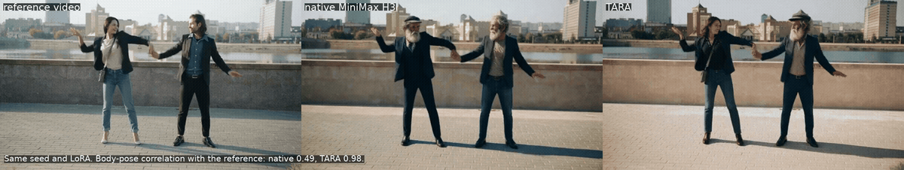
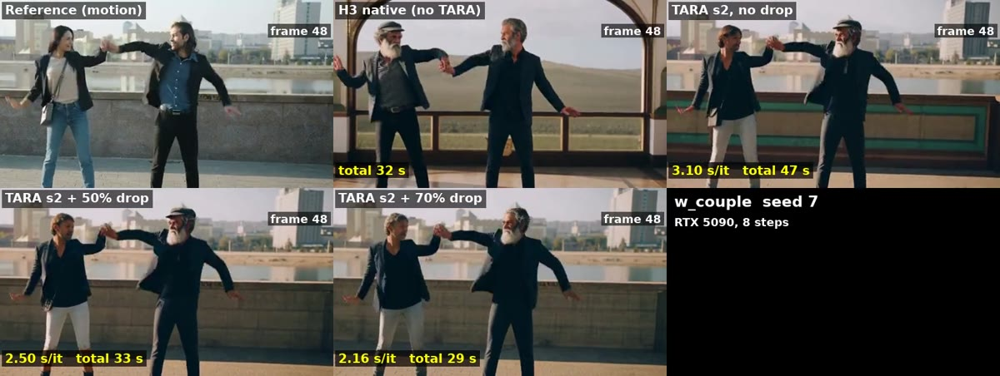

# TARA-H3

**Temporally Aligned Reference Attention for MiniMax H3**, as ComfyUI nodes.

TARA-H3 lets the generated video follow a reference video *in time* while keeping H3's native reference conditioning. The reference video stays as native H3 reference tokens. TARA-H3 then makes two changes:

1. **Shared temporal RoPE clock.** The reference video's temporal positions are shifted onto the generated video's clock, so frame *t* of the reference and frame *t* of the output share the same time coordinate.
2. **Bounded temporal attention bias.** Generated-video queries attending to reference-video keys get a soft penalty that grows with their time distance. All other attention edges stay as they are: text, pictures, reference audio, the output's self-attention and non-target queries.

It adds no learned layers. Use it with a LoRA trained with the same policy; see [Training](#training).

> **TARA is not a specific LoRA.** It is a generic mechanism for time-aligning a reference video with the generated video. The examples and measurements in this repository use one LoRA trained with it, *Motion Transfer TARA v1.0* (replace the performer of the reference video with the subject of a picture). Its results reflect that task and that training run (data, length, resolution, steps), not limits of TARA itself; a differently or better trained LoRA can behave differently, and a poorly trained one will look worse with or without TARA. For example, the drift on 10 s clips reflects a LoRA trained only on 4.5 s clips. The same training code can train any task where the output should follow a reference video in time (motion transfer, character or object replacement, restyling, relighting, effects, ...).

The full method, equations, numerical checks and limitations are in the technical report: [research/README.md](research/README.md).

## Example



Motion Transfer TARA v1.0 LoRA (one LoRA trained with TARA, not TARA itself); same seed and LoRA, with and without the TARA node. The native output drifts from the reference's framing and timing; with TARA the performers follow the reference frame by frame (body-pose correlation 0.49 → 0.98). This clip is one of 15; across all of them (3 seeds each) TARA raised motion following from 0.45 to 0.80 on close-ups and from 0.83 to 0.97 on wider shots — see [research/README.md §4.7](research/README.md). [MP4](docs/media/tara_vs_native_couple.mp4)

## Nodes

| Node | What it does |
|---|---|
| **TARA-H3 Temporal Alignment** | Applies the clock alignment and temporal bias to the MODEL. Route its output to the sampler/guider. |
| TARA-H3 Reference Attention Binding (Experimental) | Per-Picture logit gains on top of TARA (connect after the Temporal Alignment node). |
| TARA-H3 Token / Word Weight Editor (Experimental) | Prompt text-key logit gains. It needs traced conditioning from [BFS Native Reference Set to Video](https://github.com/alisson-anjos/ComfyUI-BFSNodes) or the H3 CLIP plus the exact prompt. |

Requirements: ComfyUI with native MiniMax H3 support; the reference video in **MiniMax H3 Reference to Video**; no Add Guide/first-frame guides on the same path; reference and output must share a 24 fps temporal grid.

## Attention backends

The bias is the same in every backend; only the kernel changes. The default picks the fastest one and falls back automatically.

| `attention_backend` | How | Needs |
|---|---|---|
| **auto (fastest)** (default) | Kitchen one-pass when a verified binary exists for the GPU, otherwise sage fused, then the partition backends | — |
| sage fused (triton) | One SageAttention Triton pass; the bias is computed inside the kernel, only on reference-key tiles of target-query rows | `sageattention` + `triton` |
| sage partitions | Exact log-sum-exp merge of SageAttention partitions | `sageattention` |
| flash partitions | Exact log-sum-exp merge of FlashAttention partitions | PyTorch CUDA |
| comfy kitchen | One-pass CUDA kernel from the comfy-kitchen fork (downloaded and SHA-256 verified on first use) | Linux sm80–sm120, Windows sm86/89/120 |
| flex (original) | PyTorch FlexAttention score modifier | PyTorch |
| flash augmented (one pass) | One FlashAttention pass with the bias carried in extra head dimensions (128 + latent frames); any number of tokens per frame | PyTorch CUDA |

**Kitchen one-pass kernel availability.** Prebuilt binaries (built per commit by CI, SHA-256 pinned in `tara_h3/h3_temporal_binaries.json`) cover Linux sm80/86/89/90/100/120 and Windows sm86/89/120. On any other NVIDIA GPU (sm80 or newer) with a CUDA toolkit installed, TARA-H3 builds the kernel once for that GPU from source files pinned by SHA-256 at the same commit (`nvcc` from `CUDA_HOME`/`CUDA_PATH` or `PATH`; on Windows also `cl`, e.g. from an "x64 Native Tools" prompt) and caches it. Set `TARA_H3_TEMPORAL_LOCAL_BUILD=0` to skip local builds, `TARA_H3_TEMPORAL_AUTO_INSTALL=0` to skip the kernel entirely, `TARA_H3_TEMPORAL_CACHE_DIR` to move the cache. Without either, auto uses sage fused (Triton compiles it on first use).

Fallback chain for auto: Kitchen one-pass → sage fused → sage partitions → flash partitions; each failure is logged once. With **Model Sparse Attention (sol-attn)** connected, TARA uses the sol one-pass kernel with the bias fused in (and the dense chain for steps/blocks that sol leaves dense). With `strength 0` only the clock alignment remains and the selected backend runs unchanged.

## Reference token drop (experimental)

`reference_token_drop` (0–0.95) leaves out that share of the motion video's tokens that are most predictable from the previous frame — mostly static background — so the DiT sequence is shorter. The idea comes from [CodecOPSD](https://arxiv.org/abs/2611.31184); TARA-H3 uses its own implementation (block matching on luma, no H.264 encode, no extra training). Latent frame 0 is always kept and the kept tokens keep their original positions, so TARA's clock alignment is unchanged. Connect the same frames that go into **MiniMax H3 Reference to Video** to `reference_frames`.

With strength > 0 the bias runs in the sage fused kernel reading a time per token row (`flash augmented`, an exact one-pass FlashAttention fallback, is used if Triton/Sage are missing); with strength 0 the selected backend runs unchanged. Not yet combined with Reference Binding, Token Weights or sparse attention.



5 clips × 3 seeds, full TARA, RTX 5090: seconds per step 3.81 → 2.95 → 2.56 (107 frames) and 12.1 → 9.1 → 7.5 (243 frames) for 0 / 50 / 70 % drop. Body-pose following is unchanged; fine face motion drops slightly (about −0.05 at 50 %, up to −0.1 at 70 %). Use 50 % as a safe setting, 70 % for wide/body shots, no drop or 50 % for talking close-ups. Comparison videos (seconds per step and total time under each panel): [cu_shots](docs/media/token_drop/cu_shots_s2.mp4) · [w_dance](docs/media/token_drop/w_dance_s2.mp4) · [w_couple](docs/media/token_drop/w_couple_s2.mp4) · [long_dance](docs/media/token_drop/long_dance_s2.mp4) · [long_wide](docs/media/token_drop/long_wide_s2.mp4); strength 0 and all tables in [`research/eval/results/token_drop_summary.md`](research/eval/results/token_drop_summary.md).

## Where the bias is applied

`bias_preset` trades exactness for speed:

| Preset | Bias on | Notes |
|---|---|---|
| **full** (default) | every block, every step | matches training |
| sigma >= 0.90 (fast) | high-noise steps only | the reference timing is laid down early; later steps run native attention |
| blocks 0-11 (fast) | first 12 transformer blocks only | fastest; some reference leakage observed |
| custom | `bias_block_start`, `bias_block_end`, `bias_sigma_min` | |

## Speed

RTX 5090, MiniMax H3 Ref2VA INT8, DMD 8 steps, 416x736, 107 frames, one reference picture plus one reference video. Seconds per sampling step, same seed:

| Attention | s/it | PSNR vs exact flash partitions |
|---|---:|---:|
| sage, no temporal bias (reference speed) | ~3.4 | — |
| flash partitions | 7.02 | reference |
| sage partitions | 5.54 | 26.5 dB |
| sage fused (triton) | 4.26 | 27.5 dB |
| **Kitchen one-pass (auto)** | **3.81** | **28.3 dB** |
| sage fused, `sigma >= 0.90` preset | 3.94 | 25.9 dB |
| sage fused, `blocks 0-11` preset | 3.58 | 17.8 dB |
| sol-attn (tau 1.3) + TARA, Kitchen one-pass | 4.93 | 25.2 dB |
| sol-attn (tau 1.3) without TARA | 3.22 | (does not follow the reference) |

Two runs of the same configuration differ by about 25–28 dB PSNR (quantized kernels are not bit-exact), so values in that range match the exact reference visually. At this short sequence (24k tokens) sol is not faster than dense; its gain grows with sequence length.

Without the TARA LoRA, the base Ref2VA model reproduces the reference video's content in this character-replacement setup, with or without TARA. TARA aligns time; the LoRA learns to use the reference video for timing while taking identity from the pictures.

## Recommendations from the measurements

- **Reference resolution matters more than output resolution.** The LoRA was trained with 672x384 reference videos (252 tokens per latent frame). At 720p with a 704x1280 reference, strength 2 lost the reference timing on some seeds; a 416x736 reference with a 720p output, or strength 0.5–1.0, tracked it without leaking the reference person's appearance. `strength_scale = auto` lowers the strength for dense references (2 → 1.07 at 704x1280); it is opt-in until evaluated on more clips.
- **Evaluation (15 clips × 3 seeds, [research/README.md §4.7](research/README.md)):** against native MiniMax H3, TARA's clock alignment raises motion following from 0.45 to 0.80 (face motion, close-ups) and from 0.83 to 0.97 (body pose, wider shots; native lags ~3 frames and fades on 10 s clips). The bias adds little on top, so `strength 0` (clock alignment only, native attention speed on any backend) is a good fast mode; keep strength 2 for the trained behavior.
- **Stay close to the training length (4.5 s).** Beyond it, outputs drift from the reference with or without the bias; use clips of about that length or windowed generation.
- `sigma >= 0.90` is a good speed preset at the training resolution, but not for dense references.

## Install

```bash
cd ComfyUI/custom_nodes
git clone https://github.com/alisson-anjos/TARA-H3
pip install sageattention triton   # optional, for the fastest backends
```

Example workflows are in [examples/](examples/). They use the TARA-H3 node IDs (`TARAH3TemporalAlignment`, ...). The same nodes also ship in ComfyUI-BFSNodes under their `BFS...` IDs for now.

## Training

TARA-H3 needs a LoRA trained with the same clock alignment and bias. The training implementation is in the ai-toolkit fork:

- Snapshot: [ai-toolkit @ tara-h3-v0.1.0](https://github.com/alisson-anjos/ai-toolkit/tree/tara-h3-v0.1.0)
- Policy and layout: [`toolkit/h3_native_temporal.py`](https://github.com/alisson-anjos/ai-toolkit/blob/tara-h3-v0.1.0/toolkit/h3_native_temporal.py)
- Example config: [`config/examples/train_h3_native_temporal.yaml`](https://github.com/alisson-anjos/ai-toolkit/blob/tara-h3-v0.1.0/config/examples/train_h3_native_temporal.yaml)
- Setup notes: [`docs/H3_NATIVE_TEMPORAL.md`](https://github.com/alisson-anjos/ai-toolkit/blob/tara-h3-v0.1.0/docs/H3_NATIVE_TEMPORAL.md)

Set `native_temporal_alignment: true`, keep `align_video_refs: false` and `align_image_refs: false`, and keep the native reference RoPE layout. Inference defaults (`strength 2.0`, `window 0.2 s`, `falloff 0.25 s`, `cap 6.0`) match the training defaults.

## Development

```bash
python -m pytest -q tests                  # unit tests (CPU)
python tools/compile_fused_kernel.py        # AOT-compile the fused Triton kernel for sm80-sm120, no GPU needed
python tools/verify_kitchen_manifest.py     # pinned Kitchen/Sol binaries exist with the pinned SHA-256
```

CI runs all three on every push and pull request. The optional Kitchen/Sol CUDA extension is built and released per commit by [alisson-anjos/comfy-kitchen](https://github.com/alisson-anjos/comfy-kitchen/tree/feat/h3-native-temporal); `tara_h3/h3_temporal_binaries.json` pins the release.

## License and citation

GPL-3.0; see [LICENSE](LICENSE) and [NOTICE](NOTICE). The fused kernel is derived from [SageAttention](https://github.com/thu-ml/SageAttention) (Apache-2.0). To cite the method, use [research/CITATION.cff](research/CITATION.cff).
