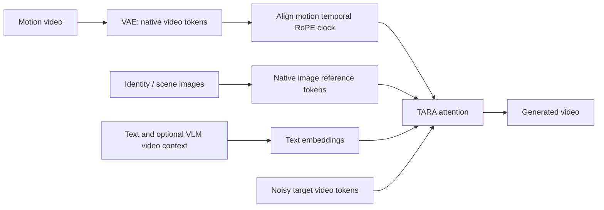
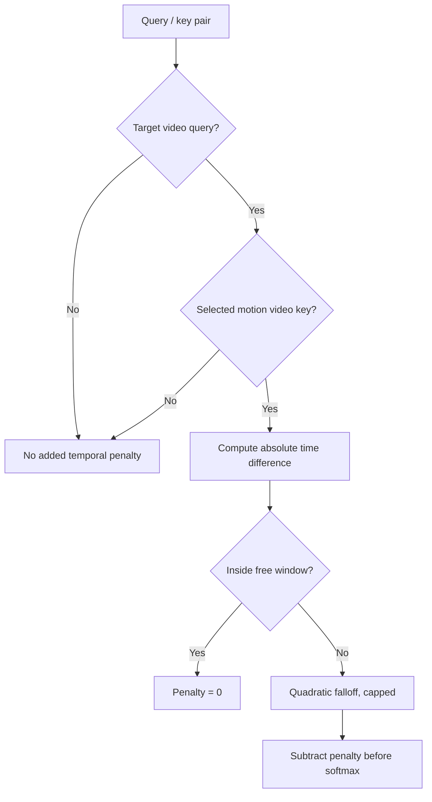

# TARA-H3: Temporally Aligned Reference Attention for Native Video Conditioning

**Alisson Anjos** · Technical report v0.2.1 · November 24, 2026  
**Status:** experimental implementation and preliminary evidence; not peer reviewed.

## Abstract

Native reference-video conditioning and frame-aligned video guidance provide different ways to control video generation. In our MiniMax H3 experiments, native reference conditioning alone did not reliably reproduce the timing of a source performance. We introduce **TARA-H3**, an implementation that retains H3's native reference-video latent tokens, aligns the motion reference's temporal rotary coordinates with the generated video's clock, and adds a bounded temporal penalty only to target-video queries attending to motion-reference keys. Image references keep their native coordinates. No new learned layers are required by the attention modification itself. We implement the policy through FlexAttention, exact Flash and Sage partition decompositions, a SageAttention Triton kernel with the bias fused in, and optional custom one-pass Comfy Kitchen and Sol Attention kernels. We report numerical checks, isolated attention timings, end-to-end sampling cost on one clip (the fastest exact backend is about 12% slower per step than dense SageAttention without the bias, versus about 2× for the original partition method), single-clip ablations and a 15-clip, three-seed evaluation of motion following against native H3 (temporal clock alignment raises face-motion correlation from 0.45 to 0.80 on close-ups and body-pose correlation from 0.83 to 0.97 on wider shots, with the bias adding little on top), and distinguish these from informal video observations. This report provides an implementation-oriented account, not a claim of first invention of temporal attention or a demonstrated universal improvement.

## 1. Motivation and scope

We want the output to follow the source video's performance while allowing identity, clothing, style, and setting to change according to separate references and instructions. A useful distinction is:

| Mode | Motion video representation | Alignment mechanism |
|---|---|---|
| Native H3 reference | Native reference-video tokens | The model's existing learned reference behavior |
| Add Guide / aligned guide latents in our pipeline | Guide video latent tokens | Existing aligned-guide conditioning contract |
| TARA-H3 | **Native reference-video tokens remain native** | Shared temporal RoPE clock plus selective temporal logit bias |

TARA-H3 does **not** remove video latents: a VAE still encodes the motion video. It removes the need to use the **Add Guide conditioning path** in this mode. The text encoder's video understanding and the diffusion transformer's reference latents are distinct pathways; neither should be confused with the attention policy described here.

The implementation is for the MiniMax H3 Ref2VA packing contract. Applying the idea to another architecture requires adapting token ownership, clocks, positional encoding, and attention kernels. It is not a drop-in patch for every video model.

## 2. Method

### 2.1 Token ownership

Let the packed sequence contain text tokens, reference-image tokens, reference-video tokens, optional audio tokens, and generated-video tokens. Let **M** denote the explicitly selected motion-reference video tokens and **T** the generated-video tokens. Reference identity images are not members of M.

The selection follows the reference's **source channel**, not its location in the packed sequence. This matters because image and video references may be reordered during packing. Exactly one selected motion video is required. Padding and audio rows are not accidentally treated as motion-video keys.



### 2.2 Shared temporal RoPE clock

The selected reference video's temporal coordinates are translated so its first temporal position coincides with the target video's first temporal position:

$$
\tau'_m = \tau_m + (\tau_{T,0} - \tau_{M,0}).
$$

Only this temporal coordinate is changed. Reference-image coordinates and the motion video's native spatial grid are preserved. The implementation checks that motion and target use matching temporal grids after this translation. It rejects mismatches rather than silently stretching one performance to a different duration.

A spatially downscaled motion reference can therefore accompany a larger output grid. Temporal alignment does not imply pixel-to-pixel spatial correspondence. Reducing guide resolution can discard small gestures, mouth movement, or other useful detail.

### 2.3 Selective bounded temporal bias

For a query i and key j, let the unmodified attention logit be:

$$
s_{ij}=q_i^\top k_j/\sqrt{d}.
$$

The modified logit is:

$$
\widetilde{s}_{ij}=s_{ij}-\mathbf{1}[i\in T\land j\in M]\,p(|t_i-t_j|),
$$

where times are measured in seconds and:

$$
p(\Delta t)=\min\left(c,\;\lambda\left[\frac{\max(0,\Delta t-w)}{f}\right]^2\right).
$$

Here w is the unpenalized temporal window, f the falloff scale, lambda the strength, and c the maximum penalty. Initial experimental settings are:

| Parameter | Value |
|---|---:|
| Free window w | 0.20 seconds |
| Falloff f | 0.25 seconds |
| Strength lambda | 2.0 |
| Cap c | 6.0 |

The penalty is soft: distant motion keys remain available. It does not force a frame match, assign identity, or guarantee optical-flow alignment. Text, identity-image keys, reference audio, target self-attention, and non-target queries receive no **additional temporal penalty**. A sparse backend can still approximate those interactions according to its own rules.



Setting strength or cap to zero disables this bias. **It does not undo the RoPE clock alignment.** A true native baseline must disable both changes.

## 3. Efficient attention implementations

### 3.1 FlexAttention reference path

The initial CUDA implementation uses a score modifier that evaluates the bias during attention. It stores token ownership and times in linear-sized metadata instead of allocating an S-by-S bias matrix. Its CPU dense oracle is restricted to tiny test sequences.

Shape-dependent compilation and the resulting runtime were problematic in some local inference workloads. This motivated inference alternatives. The ai-toolkit training path and the BFS inference kernels are separate implementations of the same intended temporal policy; switching an inference backend does not automatically change the training backend.

### 3.2 Flash Partitions

Partition the keys into disjoint groups, evaluate attention on each group with its applicable bias, and combine the partial outputs using their log-sum-exp normalizers. If group g returns output o_g and log normalizer l_g, then:

$$
o=\sum_g\exp\left(l_g-\operatorname{LSE}(l_1,\ldots,l_G)\right)o_g.
$$

This is an **exact decomposition of the specified softmax attention in real arithmetic**, subject to floating-point implementation differences. Averaging partition outputs without these normalizers is not equivalent. Grouping motion keys by timestamp makes the temporal penalty constant within each relevant query-time/key-time group. This avoids a dense bias tensor and compilation of a new full attention graph, but introduces multiple calls and merge work.

### 3.3 Comfy Kitchen one-pass extension

We add an optional native kernel that evaluates the temporal penalty inside the attention computation. This removes the earlier per-frame attention loop. Quantization and preprocessing follow the supported Kitchen path; the custom score handling implements the temporal policy. Tiles with uniform penalties can use shortcuts, while mixed temporal boundaries require per-score handling.

"One pass" here describes one attention invocation/pipeline for the packed sequence, **not** one diffusion step, one kernel launch for the entire model, or an operation with no preprocessing. Kitchen's quantized arithmetic is not numerically identical to a full-precision dense oracle.

### 3.4 Sol Attention one-pass extension

The Sol extension integrates the policy with its routing and exact-attention consumer. Conditioning keys are handled by the exact path; other interactions retain Sol's sparse/pooled approximation. Consequently, **Sol is not an exact replacement for dense attention**, even when it implements the same temporal penalty. Its speed and visual quality must be evaluated independently.

These extensions are project-specific additions, not a claim that upstream Kitchen or upstream Sol already provides this policy. Prebuilt binaries and source compilation support are separate distribution mechanisms, with explicit compatibility checks.

### 3.5 Sage Partitions (v0.2.0)

The partition decomposition of Section 3.2 only needs each partition's output and natural-log normalizer. SageAttention returns both (`return_lse=True`), so the same exact decomposition runs on INT8 SageAttention kernels instead of FlashAttention. The numerical difference to Flash Partitions is of the same size as the difference between dense SageAttention and dense FlashAttention.

### 3.6 Sage Fused: the bias inside a Triton kernel (v0.2.0)

The penalty depends only on the pair (query frame, key frame), and only target-query × motion-key pairs receive it. We modify SageAttention's per-block INT8 Triton kernel (Apache-2.0) as follows:

- the key loop is split at the motion-video rows; keys before and after them run the unmodified loop;
- motion keys of query tiles that overlap the target rows add the penalty, computed in registers from a per-latent-frame time vector (H3's first latent frame is shorter, so the clock is not uniform);
- non-target queries inside a mixed tile receive no penalty.

This is a single attention pass with no partitions and no FP32 merges. It needs only `sageattention` and `triton` (no compiled extension) and is compiled ahead of time for sm80–sm120 in CI. On a non-uniform clock it matches Flash Partitions to a mean absolute difference below 2·10⁻³ in the unit tests.

### 3.7 Backend selection and bias scheduling (v0.2.0)

`auto` picks the Kitchen one-pass kernel when a verified binary exists for the GPU, otherwise Sage Fused, then Sage Partitions, then Flash Partitions; each failure is logged once per model. With Model Sparse Attention (sol-attn) connected, the Sol one-pass kernel is used; steps and blocks that sol leaves dense use the dense chain. With zero strength or cap, only the clock alignment remains and the selected attention backend runs unchanged.

The bias can also be restricted in time or depth: only at noise levels σ ≥ σ_min (later steps run native attention), or only in a block range. These are inference-time approximations of the trained policy and are evaluated in Section 4.4.

## 4. Preliminary evidence

### 4.1 Numerical checks

The accompanying [numerical verification](evidence/numerical_verification.json) covers FP16/BF16, short sequences of 53 and 1,253 rows, and comparisons against an FP32 oracle. Recorded dense Kitchen relative errors are approximately 1–2%, depending on the case; these include quantized arithmetic. Sol's all-keys-exact checks exercise a restricted numerical configuration and do not establish production sparse equivalence.

The largest recorded relative difference between Sol's one-pass and frame-wise paths in those cases is approximately 2.16e-5. Additional [edge and bridge checks](evidence/edge_and_bridge.json) cover parameter boundaries and the actual BFS bridges. These are finite test cases, not a proof covering every input, GPU, or toolchain.

### 4.2 Isolated attention timing

Hardware: **NVIDIA RTX PRO 6000 Blackwell Workstation Edition**. PyTorch: **2.12.0+cu130**. Q shape: **[1, 56, 42836, 128]**. The run had concurrent training and used **one warmup plus one timed evaluation per implementation**.

| Implementation | Recorded attention time |
|---|---:|
| Flash Partitions | 423.18 ms |
| Kitchen frame-wise | 541.30 ms |
| Kitchen one-pass | 246.34 ms |
| Sol frame-wise | 2675.20 ms |
| Sol one-pass | 216.26 ms |

Raw measurements: [attention_benchmark.json](evidence/attention_benchmark.json).

These numbers demonstrate feasibility and motivate further measurement. They are **not** full-model throughput, controlled multi-run statistics, RTX 5090 measurements, a comparison at matched visual quality, or a general speedup guarantee. Quantized and sparse implementations have different numerical behavior.

### 4.3 Informal workflow observations (v0.1.0)

In author-run ComfyUI tests, a motion-transfer LoRA previously trained using aligned guide latents also worked with the native temporal patch. A newly trained early temporal checkpoint showed weaker identity retention in some clips. These observations suggest that useful learned behavior can transfer across conditioning modes, but do not isolate the contribution of weights, prompts, RoPE alignment, attention bias, or sampling settings.

The user-facing demonstration page includes synchronized videos and reference images: [BFS Flash Partitions documentation](https://github.com/alisson-anjos/ComfyUI-BFSNodes/blob/feat/h3-native-temporal/docs/H3_FLASH_PARTITIONS.md). Demonstrations are qualitative examples, not a representative benchmark. Pixel difference and PSNR against a guide are not sufficient quality metrics when subjects or backgrounds are intentionally changed.

### 4.4 End-to-end sampling cost and fidelity (v0.2.0)

Setup: RTX 5090, PyTorch 2.14 (CUDA 13.0), MiniMax H3 Ref2VA INT8, DMD 8-step LoRA plus the TARA motion-transfer LoRA v1.0, 416×736, 107 frames (24,087 packed rows, 9,568 motion rows), one reference picture and one reference video, fixed seed and prompt. Seconds per sampling step after warm-up; PSNR of the decoded video against Flash Partitions. Single runs: these are measurements on one clip, not distributions.

| Attention | s/it | PSNR vs Flash Partitions |
|---|---:|---:|
| SageAttention, no temporal bias | ~3.4 | — |
| Flash Partitions | 7.02 | reference |
| Sage Partitions | 5.54 | 26.5 dB |
| Sage Fused (Triton) | 4.26 | 27.5 dB |
| Kitchen one-pass | 3.81 | 28.3 dB |
| Sage Fused, bias only at σ ≥ 0.90 (5 of 8 steps) | 3.94 | 25.9 dB |
| Sage Fused, bias only in blocks 0–11 | 3.58 | 17.8 dB |
| sol-attn (τ = 1.3) + TARA, Sol one-pass | 4.93 | 25.2 dB |

Repeating one configuration with quantized kernels gives 25–28 dB, so the exact backends and the σ ≥ 0.90 schedule are visually indistinguishable from the reference, while restricting the bias to blocks 0–11 changes the result and lets reference appearance leak in some frames. At this length sol-attn is not faster than dense attention; its benefit grows with sequence length. The temporal Sol kernel costs about 32% more than sol-attn without the bias on its sparse steps, the Kitchen dense kernel about 12% more than dense SageAttention.

### 4.5 Ablations on the same clip (v0.2.0)

- **Clock alignment and bias are both needed with the trained LoRA.** With strength 0 (clock alignment only), the reference video's appearance bleeds into the output (ghosted overlays). Without the TARA node at all (sol-attn only), the output no longer follows the reference video's framing and setting.
- **The LoRA is needed for character replacement.** Without the TARA LoRA, the base Ref2VA model reproduces the reference video's subject in this setup, with or without TARA. TARA aligns time; the LoRA learns to take timing from the reference video and identity from the pictures. We therefore do not claim a training-free method for this task.

### 4.6 Temporal following, resolution and clip length (v0.2.0)

We measure temporal following with appearance-independent signals: per-frame head yaw/pitch/roll and mouth opening (insightface 3D-68) and mean optical-flow magnitude, correlated with the reference video at the best lag in ±8 frames; and identity with ArcFace similarity to the target picture and to the reference-video person, per third of the clip. Timing correlation alone rewards copying the reference, so both are reported. These are single clips and up to three seeds; they indicate where to evaluate, not population-level effects.

- **Short clips (107 frames, 416×736).** Close-up: TARA head-yaw correlation 0.53–0.57 versus 0.35 without the bias, which also lagged by about 7 frames. Seven wide scenes (full body, two people, moving camera, back views, 90 frames): motion-flow correlation was similar with and without the bias (0.45–0.99 depending on the scene); with two people, the run without the bias replaced both in one scene, TARA only the main performer.
- **Dense references (124 frames, 704×1280 reference and output).** Strength 2 lowered timing correlation on one seed (0.55 versus 0.74 without the bias, which however copied the reference person's sunglasses and face); strength 1.0/0.5 (0.68) or a 416×736 reference with the 720p output (0.64–0.65) tracked the timing without the leak. Scaling the strength by √(252 / rows per frame) (2 → 1.07) improved one of three seeds (0.55 → 0.67) and matched strength 2 on the other two.
- **Long clips (243 frames, 10 s, 416×736).** On a close-up, the run without the bias kept the picture identity for two thirds and then reproduced the reference person (ArcFace to the picture 0.70 → 0.60 → 0.07, to the reference person 0.10 → 0.13 → 0.66). With TARA identity held (0.72 → 0.65 → 0.67; reference 0.08–0.11), but in the last third the output turned away from the reference performance. Full-body dance and two-person clips kept identity in both settings.

### 4.7 Evaluation v2: motion following against native H3 (15 clips × 3 seeds)

All measurements in this report use one LoRA trained with TARA, Motion Transfer TARA v1.0 (replace the reference video's performer with the subject of a picture); they characterize that LoRA with and without TARA at inference, not every model that can be trained with the method, and they depend on how that LoRA was trained (4.5 s clips at 672×384). TARA's purpose is temporal alignment, so v2 measures motion following only and compares three settings on the same clips and seeds: **native** MiniMax H3 reference conditioning without the TARA node, **clock only** (TARA with strength 0: temporal RoPE alignment, no bias) and **full TARA** (strength 2). Close-ups use face motion (head yaw/pitch/roll, mouth; insightface); medium, wide and full-body shots use the main performer's 17 DWPose body keypoints. Correlation with the reference at the best lag in ±8 frames; 15 clips (11 of 90–107 frames, four of 243 frames / 10 s), seeds 42/7/11, TARA LoRA v1.0 in all settings. Data and tables: [`research/eval/results`](eval/results/).

| Category (renders per setting) | Native H3 | Clock only | Full TARA |
|---|---:|---:|---:|
| Close-up, face motion (12) | 0.45 ± 0.20 | 0.80 ± 0.06 | 0.80 ± 0.07 |
| — head yaw only | 0.41 ± 0.53 | 0.79 ± 0.17 | 0.83 ± 0.13 |
| Medium/wide, body pose (15) | 0.83 ± 0.20 (lag −2.8 frames) | 0.98 ± 0.02 | 0.97 ± 0.02 |
| Two people, body pose (6) | 0.73 ± 0.28 | 0.98 ± 0.01 | 0.98 ± 0.01 |
| 10 s close-up, face motion (3) | 0.44 ± 0.06 | 0.78 ± 0.04 | 0.76 ± 0.07 |
| 10 s wide, body pose (6) | 0.72 ± 0.14 (thirds 0.88 / 0.58 / 0.66) | 0.96 ± 0.02 | 0.96 ± 0.03 |
| 10 s two people, body pose (3) | 0.91 ± 0.03 | 0.96 ± 0.01 | 0.96 ± 0.00 |

Aligning the reference video's temporal RoPE clock with the output's makes the output follow the reference performance in every category, removes the native setting's lag, keeps it from fading over 10 s clips, and sharply reduces the spread across seeds and clips. The bounded bias adds little on top of the aligned clock in these measurements (a slightly higher, less variable head-yaw correlation on close-ups), so clock-only TARA, which runs at native attention speed on any backend, captures most of the benefit. Limitations: one 10 s close-up seed left the reference performance with the bias and another reproduced the reference person without it (the 10 s clips are 2.3× the training length); identity and which subjects get replaced are outside these measures (an earlier identity analysis, v1, was withdrawn because its largest-face metric rewarded duplicated identities).

## 5. Reproduction

### Training and preview inference

The reproducible code entry points in this fork are:

Training code lives in the ai-toolkit fork ([snapshot `tara-h3-v0.1.0`](https://github.com/alisson-anjos/ai-toolkit/tree/tara-h3-v0.1.0)):

- [Temporal policy and layout](https://github.com/alisson-anjos/ai-toolkit/blob/tara-h3-v0.1.0/toolkit/h3_native_temporal.py).
- [H3 model integration](https://github.com/alisson-anjos/ai-toolkit/blob/tara-h3-v0.1.0/extensions_built_in/diffusion_models/minimax_h3/minimax_h3.py).
- [Training and inference transformer](https://github.com/alisson-anjos/ai-toolkit/blob/tara-h3-v0.1.0/extensions_built_in/diffusion_models/minimax_h3/src/transformer.py).
- [Preview pipeline](https://github.com/alisson-anjos/ai-toolkit/blob/tara-h3-v0.1.0/extensions_built_in/diffusion_models/minimax_h3/src/pipeline.py).
- [Portable training configuration](https://github.com/alisson-anjos/ai-toolkit/blob/tara-h3-v0.1.0/config/examples/train_h3_native_temporal.yaml).
- [Setup details](https://github.com/alisson-anjos/ai-toolkit/blob/tara-h3-v0.1.0/docs/H3_NATIVE_TEMPORAL.md).

```bash
git clone --branch feat/h3-native-temporal-motion https://github.com/alisson-anjos/ai-toolkit.git
cd ai-toolkit
# Install this fork's existing H3 dependencies and supply licensed model files.
# Copy the example and edit model paths, paired dataset paths, and previews.
python run.py config/examples/train_h3_native_temporal.yaml
```

Set `native_temporal_alignment: true`, keep `align_video_refs: false` and `align_image_refs: false`, and use native reference RoPE layout. Select the motion source channel explicitly. Source and target must use matching sampled temporal grids. Image-reference numbering in captions must match the actual inputs.

The patch introduces no new learned layers; whether to train an additional LoRA is a separate choice. It does **not** mean every existing LoRA will work well or that the base model becomes a reliable motion-transfer system without training.

### ComfyUI inference

Install this repository as a ComfyUI custom node package and add **TARA-H3 Temporal Alignment** after the model loaders; route its **MODEL output to the sampling guider** (the same nodes also ship in ComfyUI-BFSNodes for now). Disable conflicting Add Guide/first-frame/continuity paths. Select a supported backend; unknown attention/block replacement patches must not be silently combined.

The optional [Kitchen extension fork](https://github.com/alisson-anjos/comfy-kitchen/tree/feat/h3-native-temporal) supplies project-specific one-pass kernels; its CI builds and releases them per commit, and `tara_h3/h3_temporal_binaries.json` pins the release that TARA-H3 downloads and verifies. Follow its build/install documentation for the current compatibility matrix. GPU architecture, CUDA driver and platform compatibility still matter. A successful build or ABI check alone does not validate video quality on that platform.

## 6. Evaluation still needed

A controlled study should hold prompts, inputs, sampling settings, and seeds fixed while testing:

1. Native baseline; RoPE alignment only; temporal bias only; both combined.
2. Base weights versus existing guide-trained weights versus temporal-trained weights.
3. Several reference spatial scales with constant output resolution and temporal sampling.
4. FlexAttention/Flash Partitions versus quantized Kitchen and sparse Sol.
5. Multiple subjects, crossings, occlusions, camera cuts, long clips, humans and animals.

Measure motion correspondence, identity retention through time, prompt adherence, background edit success, temporal artifacts, peak memory, cold-start cost, and warm full-model latency. Repeat across seeds and report distributions rather than selected successes.

## 7. Limitations

Temporal proximity does not identify which person a reference belongs to. TARA-H3 does not solve reference binding, segmentation, tracking, mouth reconstruction, or occlusion by itself. It does not supply explicit 3D pose or correspondence supervision. Strong source conditioning can retain unwanted appearance or setting; weak or low-resolution conditioning can lose motion detail. Scene cuts require consistent preprocessing and evaluation. Long sequences remain expensive, and sparse/quantized kernels can change results. Audio correspondence is outside the scope of this video-only bias. No claim of novelty over all prior temporal conditioning methods is made without a broader literature review.

## 8. Attribution and citation

TARA-H3 is the project name for this implementation and experimental combination developed by **Alisson Anjos**. It builds on MiniMax H3, ai-toolkit, rotary position embeddings, attention logit biases, PyTorch FlexAttention, FlashAttention, Comfy Kitchen, and Sol Attention. Their existing authorship and licenses remain applicable. We do not claim to have invented those components. The bibliography below provides starting references; a systematic related-work comparison remains future work.

This document is an openly available **technical report/software artifact**, not a peer-reviewed paper or a DOI-registered publication. Cite the versioned Git tag for a stable snapshot. See [CITATION.cff](CITATION.cff) and [citation.bib](citation.bib).

```bibtex
@techreport{anjos2026tarah3,
  author = {Anjos, Alisson},
  title = {{TARA-H3}: Temporally Aligned Reference Attention for Native Video Conditioning},
  year = {2026},
  institution = {Independent research},
  type = {Technical report},
  number = {v0.2.1},
  url = {https://github.com/alisson-anjos/TARA-H3/tree/v0.2.1/research},
  note = {Experimental implementation; not peer reviewed}
}
```

## References

- [MiniMax H3 model and documentation](https://huggingface.co/MiniMaxAI/MiniMax-H3).
- [ai-toolkit, Ostris and contributors](https://github.com/ostris/ai-toolkit).
- Su et al., [RoFormer: Enhanced Transformer with Rotary Position Embedding](https://arxiv.org/abs/2104.09864).
- Dao et al., [FlashAttention: Fast and Memory-Efficient Exact Attention with IO-Awareness](https://arxiv.org/abs/2205.14135).
- [PyTorch FlexAttention documentation](https://docs.pytorch.org/docs/stable/nn.attention.flex_attention.html).
- [Comfy Kitchen upstream](https://github.com/Comfy-Org/comfy-kitchen); [our optional temporal extension](https://github.com/alisson-anjos/comfy-kitchen/tree/feat/h3-native-temporal). Sol-specific provenance and notices accompany the kernel source.

## Version history

- **v0.2.1 — 2026-11-24:** Evaluation of motion following against native MiniMax H3 on 15 clips × 3 seeds with face-motion and DWPose body-pose measures (Section 4.7); the v1 identity analysis was withdrawn because its largest-face metric rewarded duplicated identities.
- **v0.2.0 — 2026-11-24:** Sage Partitions, Sage Fused (Triton) and automatic backend selection; bias scheduling by noise level and block range; end-to-end sampling cost and fidelity on one clip (Section 4.4); ablations on clock alignment, bias and the LoRA (Section 4.5); report moved to the TARA-H3 repository.
- **v0.1.0 — 2026-10-23:** Initial implementation-oriented report, equations, diagrams, numerical evidence, isolated timing data, reproduction pointers, and limitations.
